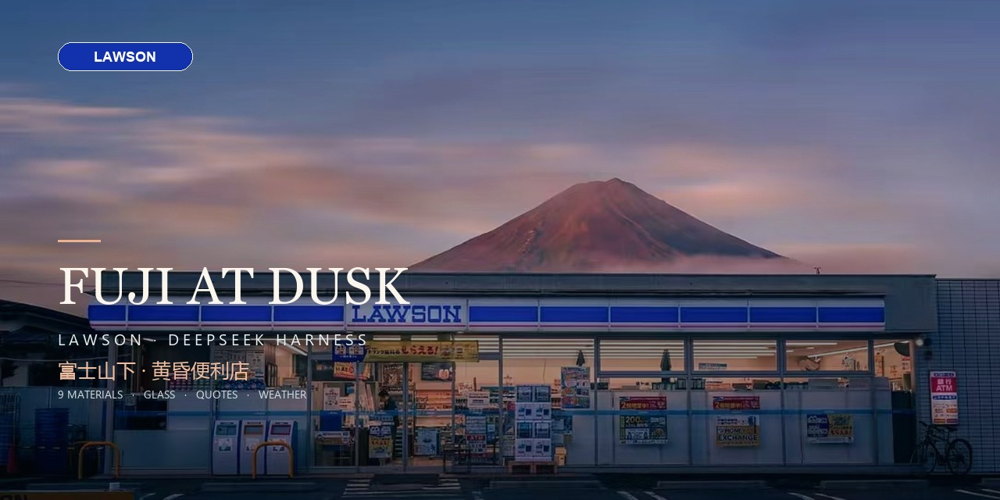

# 富士山下 · 黄昏便利店

**Fuji at Dusk · Lawson** — an image-led atmosphere skin and startup animation for
**DeepSeek Harness**.



A glass-first Harness theme built around a dusk Fuji / Lawson photograph, with
nine material finishes, edge and light-leak controls, a glass composer, a quote
bar, system time and location-aware weather.

The wallpaper was extracted from the user-provided screenshot, cleaned of the
phone UI, macOS menu bar and dock, upscaled, and re-graded for use as the
full-window background and startup frame. It is not fetched from the network.
Image rights are described in [ASSETS.md](ASSETS.md).

## 它是什么

- **全局覆盖**：照片按 `cover` 等比例铺满整个 Harness 窗口，左侧栏、右侧空栏、底部空白都共用同一张背景。
- **整窗玻璃**：照片上方是一层随设置变化的冷白玻璃膜；侧栏、右栏、框架和中心列的外壳都被压平为透明，卡片/菜单保留自己的玻璃 token，所以背景连续、文字仍然可读。
- **材质系统**：背景与玻璃表面共用一套材质语言，内置 **冷雾 / 长虹 / 烟熏 / 磨砂 / 虹彩 / 拉丝 / 纸感 / 胶片 / 雨幕** 九种材质，可调强度、纹理尺度和表面高光。
- **边缘系统**：玻璃边缘可切换 **柔和 / 金属 / 霓虹 / 斜边**，面板、输入框、语句条同时响应。
- **光效系统**：漏光颜色与强度、暗角独立调节；和材质、玻璃叠加，不是单纯换一张背景。
- **输入端同主题**：输入框卡片也使用同一套材质、玻璃、边缘与光效，和背景/语句条/设置面板一致。
- **氛围语句条**：输入框上方的全宽玻璃条，内置 **情感 / 励志 / 足球各 412 条**（每类新增 400 条，共 1236 条）；可点击换一句，默认每 2 分钟自动轮换，不遮挡会话；时间、地点、天气以大字号双行胶囊呈现。
- **时间 / 地点 / 天气**：时间实时跟随系统；地点可搜索任意城市（含国外），天气来自所选地点的 Open-Meteo 当前天气，离线时保留时间与地点。
- **语句控制面板**：氛围面板新增「语句」页，可开关整条、开关语句、开关时间天气、切换语句类型、立即换一句、搜索并切换地点。
- **主题细节**：LAWSON 蓝白条纹、富士坐标、缓慢移动的云层、便利店暖光、浮尘和胶片颗粒；色调可整体改。
- **玻璃界面**：冷白玻璃、富士暮色的桃色强调、侧栏/右栏磨砂；所有面板使用 Harness 主题 token。
- **可调亮度**：把背景压暗或提亮，适合白天和夜间使用。
- **可调玻璃**：不透明度、磨砂强度、后景柔焦独立调节；整窗玻璃膜和侧栏玻璃一起变化。
- **整体配色**：主色色板 + 自定义颜色；整体色调颜色 + 强度；饱和度；自动适配主色按钮文字对比度。
- **更多 DIY**：雾气、颗粒、构图缩放、动态开关；四组预设：黄昏 / 夜色 / 雾晨 / 胶片。
- **自动保存**：所有参数即时生效，保存在本机 `localStorage`，重启 Harness 后保留。
- **配套启动动画**：照片从暗部显影、缓慢推近，玻璃铭牌、LAWSON 条纹和标题入场，最后淡出到界面；约 4 秒，可跳过。
- **重播 / 跳过**：设置面板里有「重播开场」；点任意处、按键、滚轮或触屏可跳过。

## 打开设置

侧栏底部 Settings 旁有一个 **氛围按钮**（太阳 + 滑杆图标）。点击后打开右上角玻璃面板，分五页：

**画面**
- 背景亮度
- 饱和度
- 雾气
- 颗粒
- 构图缩放
- 动态氛围开关

**材质**
- 冷雾 / 长虹 / 烟熏 / 磨砂 / 虹彩 / 拉丝 / 纸感 / 胶片 / 雨幕
- 材质强度
- 纹理尺度
- 表面高光
- 玻璃不透明度
- 侧栏覆盖（0% 时左栏完全透出壁纸）
- 玻璃磨砂
- 后景柔焦
- 边缘：柔和 / 金属 / 霓虹 / 斜边

**光效**
- 漏光颜色
- 漏光强度
- 暗角

**配色**
- 主色色板：桃 / 盐 / 苔 / 紫 / 金
- 自定义主色
- 整体色调颜色
- 色调强度

**语句**
- 显示/隐藏整条环境语句条
- 显示/隐藏语句
- 每 2 分钟自动换句开关
- 显示/隐藏时间与天气
- 语句类型：情感 / 励志 / 足球 / 混合
- 立即换一句
- 当前地点与地点搜索（国内、国外均可）
- 常用地点快捷切换

顶部预设：**黄昏 / 夜色 / 雾晨 / 胶片**。

## 安装

本仓库是一个 **DeepSeek Harness host + client 插件（bundle）**，不是独立网页。

```bash
git clone https://github.com/kk0421/lawson-fuji-skin.git
```

在 DSH desktop profile 中：

1. 把 `lawson-fuji-skin` 放到 profile 的包目录，通常是
   `~/.dsh/profiles/desktop/node_modules/lawson-fuji-skin`（复制或做 junction）。
2. 在 profile 的 `package.json` 的 `dsh.profile.bundles` 中加入
   `lawson-fuji-skin`。
3. 刷新 Harness 页面；启动动画会在下一次整页加载时出现。

不同 DSH 版本可能使用插件管理器安装本地 bundle；只要 bundle 被加载，主题即可生效。

## 兼容性

- 开发和测试版本：DeepSeek Harness `0.2.1-rc.2`（desktop profile）。
- 主题依赖 Harness 的 client slot `sidebar.footer.action`、`shell.overlay`、
  `conversation.input.dock`，以及 host 的 `webServer`。
- Harness 大版本升级后 slot 名称或 host API 可能变化；如失效，请提 issue。

## License

- 代码与文档：[MIT](LICENSE)。
- `bg.jpg` / `docs/preview.jpg`：不在 MIT 范围内，版权归原权利人；详见
  [ASSETS.md](ASSETS.md)。
- 非官方主题，与 Lawson、富士山相关权利方及 DeepSeek 无隶属关系。

## Credits

- 背景照片：由用户提供并清理为本地主题素材。
- 天气与地点：Open-Meteo，无需 API Key。
- 没有第三方运行时依赖，没有远程字体、CDN 或遥测。

## 隐私

- 设置保存在本机 `localStorage`。
- 地点搜索和天气会把查询/坐标发送给 Open-Meteo；不发送聊天内容。
- 主题自身不包含分析或上报代码。

## 开发

见 [CONTRIBUTING.md](CONTRIBUTING.md) 和 [CHANGELOG.md](CHANGELOG.md)。

## 关闭

在 **插件** 页停用或卸载 `lawson-fuji-skin`。停用会移除照片背景、玻璃变量和氛围按钮，并结束正在播放的开场。

## 技术说明

- Host 半提供 `/lawson-fuji-skin/bg.jpg`，并把开场脚本注入 `index`；同时代理 Open-Meteo 的地点搜索与当前天气，避免浏览器跨域问题。
- 地点搜索和天气会把你输入的查询 / 所选坐标发给 Open-Meteo；不使用 API Key，不上传聊天内容。
- 照片资产为本地 `bg.jpg`（约 300 KB，2168×1228），作为整窗背景和启动动画帧，不依赖远程纹理。
- 材质系统是纯 CSS：用重复渐变、径向渐变、锥形渐变与混合模式模拟长虹、磨砂、虹彩、拉丝、纸感、雨幕等表面；同一套材质同时作用于背景和玻璃组件。
- 边缘、漏光、暗角、高光都是 CSS 自定义属性与叠加层；不引入 WebGL 或外部材质文件。
- 背景运动、云、雾、暖光和浮尘是 CSS 动画；颗粒、色调、玻璃和暗角是叠加层。动态关闭或系统 `prefers-reduced-motion` 时暂停。
- 设置通过 CSS 自定义属性与本地设置驱动，材质/玻璃/亮度调整不重载页面；天气失败时只显示离线状态，不影响主题与语句。
